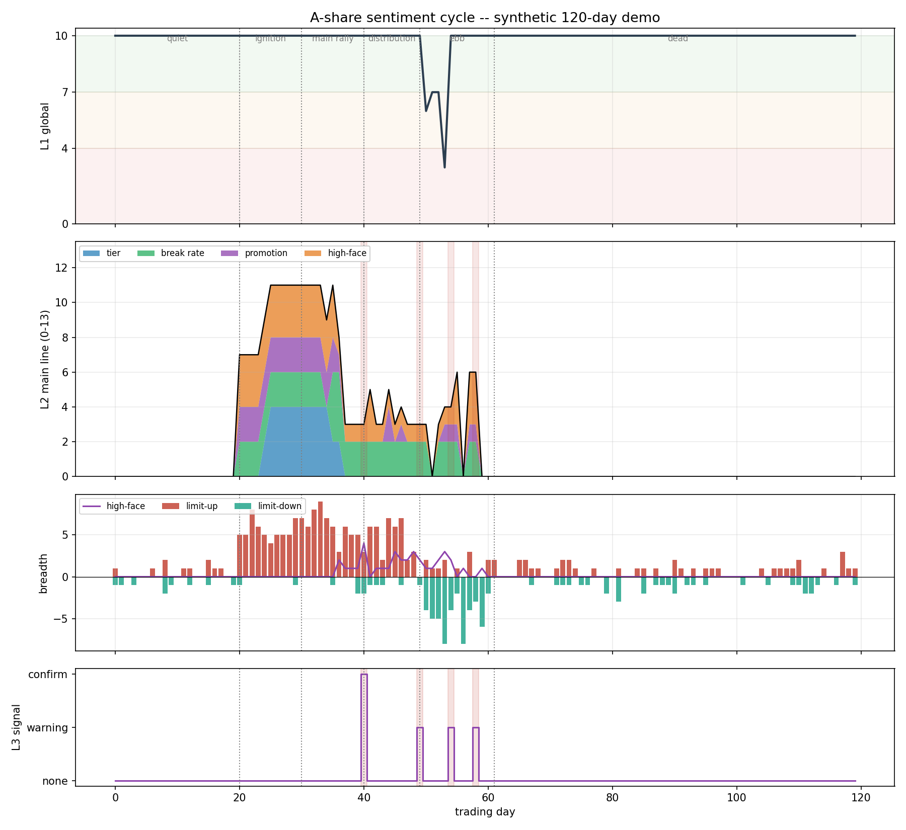

# A-Share Sentiment Cycle

**A rule-based state machine that reads the speculative mood of the Chinese A-share market
from limit-up breadth — and tells you when it is contracting.**

No training, no labels, no black box: every number below is a bounded, auditable score you
can argue with. Pure Python, under 1,000 lines of core logic, 21 unit tests.

[English](README.md) | [中文](README.zh-CN.md)



---

## The question it answers

Every trading day, in one line:

> Is speculative risk appetite **expanding**, **holding**, or **contracting** — and if it is
> contracting, has the market produced *two days of evidence*?

It does not predict the index. It classifies the tape into a regime and maps that regime to a
position-size ceiling. The output is a state (`T0` flat … `T5` 25%/90%), not a price target.

A-share short-term sentiment runs in cycles — *freeze → ignition → main rally → climax →
divergence → ebb → freeze* — and each phase has observable proxies: the number of limit-ups,
the break rate of high boards, the promotion rate of yesterday's sealed names, whether the
leader sealed again, and how many hot stocks gave back 8% intraday. This repo turns those
proxies into three scores.

---

## How it reads the tape

```
stock pool ──► daily bars (unadjusted) ──► per-stock flags ──► sector aggregation
                                                                    │
                                    ┌───────────────────────────────┘
                                    ▼
                    L1 global  0-10    index stress · limit-down/limit-up ratio · high-face count
                    L2 sector  0-13    tier completeness · break rate · promotion rate · high-face
                    L3 leader  none    leader failed to seal · sky-floor events
                                    │
                                    ▼
                         two-day ebb confirmation ──► dynamic stops ──► position tier
```

### The three scores

| Layer | Range | What it measures | Example signal |
|---|---|---|---|
| **L1 global** | 0–10 | Is the whole market risk-on? | HS300 −3% ⇒ score 6, forced flat |
| **L2 main line** | 0–13 | Is the leading sector's ladder intact? | 3+ stocks at 4 boards, break rate below its own baseline ⇒ 11 |
| **L3 leader** | none/warn/confirm | Is the leader still sealing? | leader unsealed 2 days, or 2 sky-floors ⇒ `confirm` |

L2 deliberately scores **deviations from a rolling 20-day baseline**, not absolute levels: a
market where 40% of high boards always break is not "bad" if that is its normal. The day's
value is compared to the mean of the last 20 stored values before being appended, so the score
cannot feed on itself.

### Position tiers

| L2 | Single | Total | Tier |
|---|---|---|---|
| ≥ 11 | 25% | 90% | T5 |
| ≥ 8 | 20% | 70% | T4 |
| ≥ 5 | 10% | 30% | T3 |
| ≥ 2 | 5% | 10% | T2 |
| < 2 | 0 | 0 | T1 (flat) |
| systemic risk | 0 | 0 | T0 (flat) |

L2 is capped at 13 by construction. The original notebook cut the top tier at `≥ 16`, so the
25%/90% tier was mathematically unreachable — one of several bugs fixed here (see below).

---

## Quick start

```bash
pip install -r requirements.txt

# Offline: synthetic 120-day market, no baostock, no network
python examples/demo_sentiment_cycle.py

# Tests
python tests/test_indicators.py
python tests/test_sentiment.py
```

Live, against baostock (free, no registration):

```bash
# 1. build a full-market pool (~5000 codes)
python -m src.scanner --build-pool stock_pool.csv

# 2. score one trading day; state persists in emotion_state.json
python -m src.scanner --pool stock_pool.csv --date 2026-11-10
```

As a library:

```python
from src.sentiment import Config, EmotionEngine, State
from src.indicators import Bar, to_signal

engine = EmotionEngine(Config(), State.load("emotion_state.json"))

# `signals` are already-classified daily bars (see src/scanner.py)
snap = engine.update("2026-11-10", signals, hs300_return=-0.004)

snap.l1, snap.l2, snap.l3          # 10.0, 9.0, "none"
snap.main_sector                  # "半导体" (sticky flag: snap.sector_sticky)
snap.position_tier                # "T4"
print(snap.report())              # formatted daily report
```

The core is pure: `indicators.classify()` and `EmotionEngine.update()` never touch the
network, which is why the whole pipeline is reproducible from a seeded synthetic market.

---

## Bugs this repo fixes

The project grew out of a working notebook; three successive versions are preserved verbatim
in [`legacy/`](legacy/). Reading them against the tests turned up defects that all push the
same direction — **a dead market still looks like a tradable one**:

| # | Defect | Effect | Fix |
|---|---|---|---|
| 1 | Break-up bars got `board_num = 0` | Fry rate always 0 ⇒ its component always scored 4/4 | Count the *attempted* board: streak before today + 1 |
| 2 | `prev_main_sector` written as `{'name':...}`, read as `['sector_name']` | Sector hysteresis never applied | Typed `State` dataclass |
| 3 | Fry/promotion sequences never appended (v1, v2) | Baselines forever stuck at the 0.3 default | Sequences advanced once per day in `_advance_state` |
| 4 | Top position tier gated at `L2 >= 16` | 25%/90% unreachable; top collapsed to 20%/70% | Cut on 11/8/5/2 |
| 5 | No leader ⇒ `break_days += 1` | L3 `warning` every day; two-day ebb fired constantly | No leader is `none`, and does not accrue |
| 6 | A single limit-up was treated as a main line | L2 ≈ 7 in a frozen market | `sector_min_count = 3` gate |
| 7 | `10.95 / 10 - 1 == 0.09499…` | Exact-limit closes missed | `1e-9` tolerance |
| 8 | Shared `burst_cache` across threads | Duplicate 20-day requests | Burst computed from bars already fetched — no cache needed |

Each fix has a regression test named after it, e.g.
`test_break_up_board_number_is_not_zero`, `test_no_leader_is_not_a_warning`,
`test_l2_is_capped_and_tier_reachable`.

---

## Repository layout

```
.
├── src/
│   ├── indicators.py       # limit-up / break-up / boards / high-face / sky-floor (pure)
│   ├── sentiment.py        # L1/L2/L3, ebb confirmation, sizing, JSON state (pure)
│   └── scanner.py          # baostock adapter: pool → signals, industry cache (network)
├── examples/
│   ├── demo_sentiment_cycle.py
│   └── figures/sentiment_cycle_demo.png
├── legacy/                 # the three original notebook versions, unmodified
├── notebooks/情绪因子.ipynb  # original notebook
├── docs/算法总结.md          # full derivation, parameter table, pitfalls (Chinese)
├── docs/公众号文章.md        # long-form write-up on the same ideas (Chinese)
├── tests/
└── requirements.txt
```

---

## Honest limitations

- **No backtest, no parameter validation.** Thresholds come from trading practice, not
  fitting. Nothing here is investment advice; do not wire it to an order router.
- **L1's high-face thresholds are absolute counts**, calibrated for a full-market pool. With a
  50-stock watchlist they will never fire.
- **Board limits are assumed to be 10%.** ChiNext/STAR (20%), ST (5%) and BSE (30%) names are
  misclassified — the most valuable known improvement.
- **Industry mapping lags the hot theme.** Shenwan level-2 classification is stale relative to
  new concepts, so emerging themes get split across old buckets.
- **No auction data.** The 9:15–9:25 call-auction premium is the earliest intraday signal and
  is only reported, not scored.
- **baostock is free with no SLA.** Suspended/delisted names and ex-rights `preclose` values
  are skipped, not reconciled.

Full discussion in [docs/算法总结.md](docs/算法总结.md) (Chinese), sections 8–12.

---

## Data & disclaimer

Market data from [baostock](http://baostock.com). This project is for research and education
only and is **not** investment advice.

## License

MIT
