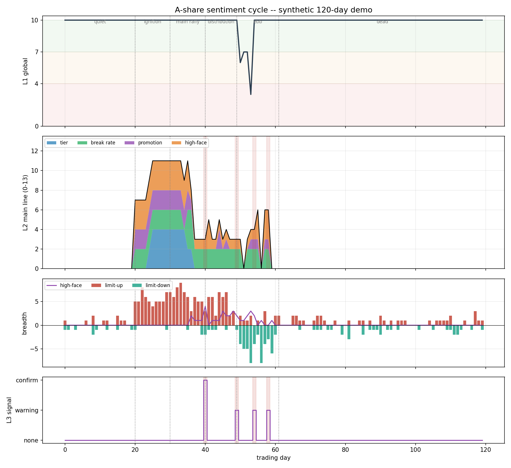

# A 股情绪周期

**从涨停家数、炸板率、晋级率读取市场投机情绪，判断它在扩散、维持还是收缩。**

不训练、不标注、不做黑箱：每个数字都是有上下界、可审计、可以拿来争论的分数。
纯 Python，核心不到 1000 行，21 个单元测试。

[English](README.md) | [中文](README.zh-CN.md)



---

## 它回答什么问题

每个交易日只回答一件事：

> 当前市场的投机情绪，是在**扩散**、**维持**，还是在**收缩**？收缩有没有被**两天的证据**确认？

它不预测指数涨跌，而是把盘面归类成一种状态，再把这种状态映射成仓位上限。
输出是状态（`T0` 空仓 … `T5` 25%/90%），不是一个价格目标。

A 股短线情绪存在明显的周期性——**冰点 → 启动 → 主升 → 高潮 → 分歧 → 退潮 → 冰点**——
每个阶段都有可观测的代理量：涨停家数、高位股炸板率、昨日封板股的晋级率、龙头是否续板、
有多少高位股当天回吐 8% 以上。仓库把这些代理量变成三层分数。

---

## 怎么读盘

```
股票池 ──► 日线（不复权）──► 逐股判定 ──► 行业聚合
                                            │
                    ┌───────────────────────┘
                    ▼
        L1 全局  0-10    指数压力 · 跌停/涨停比 · 高位大面家数
        L2 主线  0-13    梯队完整度 · 炸板率 · 晋级率 · 大面惩罚
        L3 龙头  三态    龙头断板天数 · 天地板家数
                    │
                    ▼
              双日退潮确认 ──► 动态止损 ──► 仓位档位
```

### 三层分数

| 层级 | 取值 | 衡量什么 | 典型信号 |
|---|---|---|---|
| **L1 全局** | 0–10 | 整个市场是不是风险偏好开启 | 沪深 300 跌 3% ⇒ 6 分，强制空仓 |
| **L2 主线** | 0–13 | 主线板块的梯队还完整吗 | 3 只以上 4 板、炸板率低于自身基线 ⇒ 11 分 |
| **L3 龙头** | none/warn/confirm | 龙头还封得住吗 | 断板 2 天，或 2 个天地板 ⇒ confirm |

L2 刻意比较的是**相对 20 日滚动基线的偏离**，而不是绝对水平：如果一个市场里高位股
天然有 40% 会炸板，那 40% 就是它的正常值。当日值先与最近 20 条历史均值的比较，
再追加进序列，避免当日值污染自己的基线。

### 仓位档位

| L2 | 单股上限 | 总仓上限 | 档位 |
|---|---|---|---|
| ≥ 11 | 25% | 90% | T5 |
| ≥ 8 | 20% | 70% | T4 |
| ≥ 5 | 10% | 30% | T3 |
| ≥ 2 | 5% | 10% | T2 |
| < 2 | 0 | 0 | T1（空仓） |
| 系统性风险 | 0 | 0 | T0（空仓） |

L2 的上限是 13。原 notebook 把最高档切在 `≥ 16`，数学上**永远不可达**，
所有高分日都塌缩到 4 档——这是本仓库修正的若干缺陷之一（见下）。

---

## 快速开始

```bash
pip install -r requirements.txt

# 离线演示：合成 120 个交易日的市场，不需要 baostock、不需要联网
python examples/demo_sentiment_cycle.py

# 测试
python tests/test_indicators.py
python tests/test_sentiment.py
```

接实盘（baostock 免费、免注册）：

```bash
# 1. 生成全市场股票池（约 5000 只）
python -m src.scanner --build-pool stock_pool.csv

# 2. 给某个交易日打分，状态自动落盘到 emotion_state.json
python -m src.scanner --pool stock_pool.csv --date 2026-11-10
```

作为库调用：

```python
from src.sentiment import Config, EmotionEngine, State
from src.indicators import Bar, to_signal

engine = EmotionEngine(Config(), State.load("emotion_state.json"))

# signals 是已经判定好的当日信号（见 src/scanner.py）
snap = engine.update("2026-11-10", signals, hs300_return=-0.004)

snap.l1, snap.l2, snap.l3      # 10.0, 9.0, 'none'
snap.main_sector               # '半导体'（惯性保留时为 sector_sticky=True）
snap.position_tier             # 'T4'
print(snap.report())           # 格式化日报
```

核心是纯函数：`indicators.classify()` 与 `EmotionEngine.update()` 完全不含网络，
所以整条逻辑可以用固定种子的合成市场完整复现。

---

## 本仓库修掉的坑

项目来自一个能跑的 notebook，三个版本原样保留在 [`legacy/`](legacy/)。
把实现和测试对照着读，会发现这些缺陷方向一致——**让冰点期的市场看起来仍然可交易**：

| # | 缺陷 | 后果 | 修复 |
|---|---|---|---|
| 1 | 炸板股的 `board_num` 恒为 0 | 炸板率恒为 0，该分量恒得 4 分 | 改为「昨日连板数 + 1」 |
| 2 | `prev_main_sector` 写入 `{'name':...}`、读取 `['sector_name']` | 主线惯性从未生效 | 类型化 `State` 数据类 |
| 3 | 炸板率/晋级率序列从未 append（v1、v2） | 基线永远是默认 0.3 | 每天在 `_advance_state` 中追加 |
| 4 | 最高仓位档切在 `L2 >= 16` | 25%/90% 不可达，塌缩为 20%/70% | 按真实尺度 11/8/5/2 切分 |
| 5 | 无龙头时 `break_days += 1` | L3 每天 warning，退潮持续误触发 | 无龙头返回 none，不计天数 |
| 6 | 单只涨停也被当成主线 | 冰点期 L2 ≈ 7 | 主线门槛 `sector_min_count = 3` |
| 7 | `10.95 / 10 - 1 == 0.09499…` | 正好封在涨停价的股票漏判 | `1e-9` 容差 |
| 8 | 多线程共享 `burst_cache` | 重复请求 20 日涨停统计 | 直接从已取回的 K 线计算，无需缓存 |

每一条都有以它命名的回归测试，例如 `test_break_up_board_number_is_not_zero`、
`test_no_leader_is_not_a_warning`、`test_l2_is_capped_and_tier_reachable`。

---

## 目录结构

```
.
├── src/
│   ├── indicators.py       # 涨停 / 炸板 / 连板 / 高位大面 / 天地板（纯函数）
│   ├── sentiment.py        # L1/L2/L3、退潮确认、仓位、JSON 状态（纯计算）
│   └── scanner.py          # baostock 适配：股票池 → 信号，行业缓存（联网）
├── examples/
│   ├── demo_sentiment_cycle.py
│   └── figures/sentiment_cycle_demo.png
├── legacy/                 # 原 notebook 的三个版本，原样保留
├── notebooks/情绪因子.ipynb  # 原始 notebook
├── docs/算法总结.md          # 完整推导、参数表、踩坑记录
├── tests/
└── requirements.txt
```

---

## 诚实的局限

- **没有回测，也没有参数验证。** 所有阈值来自交易经验而非拟合。本文不构成投资建议，
  不要把输出直接接到下单接口。
- **L1 的大面阈值是绝对家数**，按全市场股票池校准。自选池只有 50 只时基本不会触发。
- **涨跌幅统一按 10% 判定。** 创业板/科创板（20%）、ST（5%）、北交所（30%）会被误判——
  这是当前最值得做的一项改进。
- **行业分类落后于热点。** 申万二级更新慢，新概念会被拆散到旧行业里，主线可能识别不到。
- **没有竞价数据。** 9:15–9:25 的竞价溢价是日内最早的情绪信号，目前只输出、不参与打分。
- **baostock 免费但无 SLA。** 停牌、退市、除权日的 `preclose` 异常会被跳过，不做对账。

完整讨论见 [docs/算法总结.md](docs/算法总结.md) 第 8–12 节。

---

## 数据与免责声明

行情数据来自 [baostock](http://baostock.com)。本项目仅用于研究与教育，**不构成任何投资建议**。

## License

MIT
